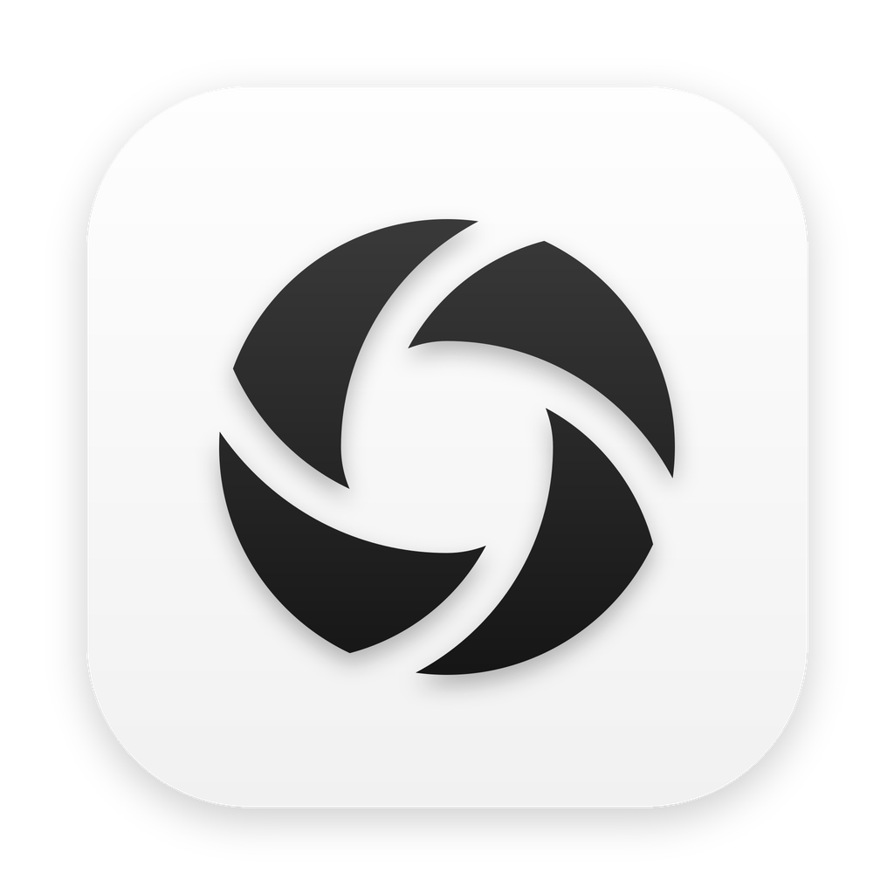

<div align="center">
  

  <h1>Pinny</h1>
  <p>macOS 原位截图、长截图、标注与贴图工具</p>

  <p>
    <a href="#功能概览">功能概览</a> •
    <a href="#快捷键">快捷键</a> •
    <a href="#构建与安装">构建与安装</a> •
    <a href="#图标生成">图标生成</a> •
    <a href="#文档">文档</a>
  </p>
</div>

---

Pinny 将截图、组件识别、原位标注、滚动长截图与剪贴板贴图收敛为两个全局入口：**`F1` 截图**与 **`F2` 贴图**。不设模式前置选择，不使用角落中转卡片。

## 功能概览

### 1. 原位截图（`F1`）

- **选区与元素识别**
  - 按 `F1` 在当前屏幕打开截图浮层（热启动首帧约 85 ms）。
  - 光标移动时通过系统辅助功能接口（`AXUIElement`）自动高亮光标下的界面元素；跨进程查询全部在后台线程执行（0.5 s 超时），不阻塞主线程。
  - 滚动鼠标滚轮或触控板切换父/子级元素；单击锁定当前元素，或按住左键直接拖拽框选。
  - 左上角提供快捷切换提示：`⌘A` 全屏、`Tab` 光标下整个窗口、`R` 上次截图区域（`,` 依次切换历史区域）。
- **选区调整与边缘吸附**
  - 选择工具下拖拽选区空白处平移选区，拖拽四边或四角调整尺寸；支持方向键逐像素移动、`⌘/⌥ + 方向键` 扩缩边缘。
  - 移动或调整尺寸时，距离屏幕边界、屏幕中线、可见窗口边或已识别元素边 `6 pt` 内自动吸附并触发触控板反馈；按住 `⌘` 暂停吸附。

### 2. 原位标注

- **面板与图标**
  - 工具栏默认贴靠选区下方，底部空间不足时自动切至上方；宽度按实际按钮自适应，macOS 26+ 采用原生液态玻璃（`.glassEffect(.regular)`）。
  - 主栏与二级属性栏使用 Hugeicons Pro 图标（常规态 `Stroke Rounded`，选中态 `Solid Rounded`），悬停提示由浮层自绘（主栏朝上、二级栏朝下）。
- **标注工具**
  - **形状**：矩形、实心矩形、椭圆（二级栏切换，每次新会话重置为矩形）。
  - **线条**：箭头（`ArrowUpRight03`）、直线（二级栏切换，每次新会话重置为箭头）。
  - **画笔与标记**：铅笔、荧光笔（支持文字行自动对齐）、文字（固定 `PingFang SC`）、模糊（马赛克 / 高斯模糊）、聚光灯、序号圆圈、水印。
  - 再次点击当前已激活的工具或按对应数字键切回「选择」工具；已有标注可点选移动、拖拽控制点或按 `⌫` 删除。

### 3. 滚动长截图

- 在 `F1` 工具栏点击「长截图」（`CarouselVertical` 图标），以当前选区直接开始截取，右侧实时显示拼接预览。
- **逐帧拼接与回滚裁尾**：按帧匹配纵向位移（置信度阈值 0.75）；若滚动过快失配，在末尾三屏范围内按行签名重定位；向上回滚时自动裁除已拼入的多余尾部。
- **固定元素去重**：自动检测顶部导航栏、底部悬浮栏等不随内容滚动的固定区域，首尾各只保留一次。
- **常驻工具栏**：选区下方常驻显示当前长图像素尺寸、上下裁剪（`Crop`）、复制、钉图、保存与关闭；会话期间通过全局按键拦截响应 `↩`、`⌘C`、`⌘S` 与 `⎋`。

### 4. 录屏

- 在 `F1` 工具栏点击「录屏」（`Video01` 图标），工具栏原地换成准备栏：选区像素尺寸、系统声音、麦克风、「开始录制」与关闭；选区仍可拖动和调整，`↩` 开始，`⎋` 回到截图工具栏。
- **录制中**：选区外侧显示红框，下方小条显示计时、暂停/继续与停止；再按 `F1` 或点击菜单栏红点同样停止。红框与小条不进入录像。
- **原位播放**：停止后在选区原位置、原尺寸循环播放，下方操作栏提供进度、MP4 / GIF 切换、重录、复制（`↩` / `⌘C`，以文件写入剪贴板）、保存（`⌘S`）与关闭（`⎋`）。一律录制为 MP4，选 GIF 时在复制或保存时才转换；未复制也未保存就关闭时会先确认。

### 5. 输出与纯图贴图（`F2`）

- **复制、保存与原位钉图**
  - **复制**（`↩` / `⌘C` / 双击选区空白处）：立即收起浮层，后台完成原始分辨率渲染并写入剪贴板，同时附带选区的屏幕坐标与逻辑尺寸。
  - **钉图**：直接将当前选区（含标注）按原屏幕坐标与逻辑尺寸钉在原位；长截图钉图时左上角对齐原选区，超出屏幕高度时等比缩放。
  - **保存**（`⌘S`）：保存至 `~/Downloads/Pinny`（首次安装默认为 `~/Desktop/Pinny`），文件名前缀 `Pinny_`。
- **纯图直角贴图（`F2`）**
  - 读取剪贴板图片或复制的图片文件并在屏幕生成贴图（若 `F1` 后台复制尚未写完，自动等待完成后贴出）。
  - 来自 Pinny 的剪贴板图片按原位置与显示尺寸恢复；外部图片在当前屏幕居中，小图保持原尺寸，超屏大图等比缩放。
  - 贴图窗口仅渲染直角图像本身，无悬浮控件。支持跨显示器（含上方外接屏）拖拽、以光标为中心滚轮缩放、**双击复制原始分辨率图像并关闭贴图**（关闭后按 `F2` 仍可恢复关闭前的位置与尺寸）。

---

## 快捷键

### 全局快捷键

| 按键 | 功能 |
| :--- | :--- |
| `F1` | 打开原位截图浮层 |
| `F2` | 将剪贴板中的图片或图片文件贴到屏幕 |

### 选区阶段（未确定选区）

| 操作 / 按键 | 功能 |
| :--- | :--- |
| 移动光标 | 高亮光标下的窗口或界面元素 |
| 滚轮上 / 下 | 切换父级 / 子级元素 |
| 左键单击 / 拖拽 | 选中当前高亮元素，或手动框选区域 |
| `⌘A` | 选中当前显示器全屏 |
| `Tab` | 选中光标下的整个窗口 |
| `R` / `,` | 复用上次截图区域 / 依次切换最近区域 |
| `C` | 复制放大镜当前像素颜色值 |
| `⎋` / 右键单击 | 取消截图 |

### 标注阶段（已确定选区）

| 操作 / 按键 | 功能 |
| :--- | :--- |
| 拖拽选区空白处 | 平移选区 |
| 拖拽四边 / 四角 | 调整选区尺寸（按住 `⌘` 暂停边缘吸附） |
| 方向键 | 按像素微调选区位置 |
| `⌘` / `⌥` + 方向键 | 向外扩展 / 向内收缩选区边缘 |
| `1` – `9`、`0` | 切换标注工具（再次按下切回选择工具） |
| `,` / `.` | 减小 / 增大当前标注描边粗细 |
| `⌘Z` / `⇧⌘Z` | 撤销 / 重做标注 |
| `⌫` | 删除选中的标注 |
| `↩` / `⌘C` / 双击空白处 | 复制原始分辨率截图并关闭浮层 |
| `⌘S` | 保存截图至导出目录 |
| `⎋` | 取消截图 |

### 贴图窗口

| 操作 / 按键 | 功能 |
| :--- | :--- |
| 左键拖拽 | 移动贴图（可跨越菜单栏进入上方外接屏） |
| 滚轮 / 双指滚动 | 以光标为中心等比缩放贴图 |
| 双击贴图 | 复制原始分辨率图像并关闭当前贴图 |
| `⎋` | 关闭当前聚焦的贴图 |

---

## 构建与安装

**环境要求**：macOS 13.0+（原生液态玻璃需 macOS 26+），Xcode 15.0+，Apple Silicon (`arm64`)。

日常安装使用 **Release 构建**配合本地开发证书签名，以保证覆盖更新后 macOS 的「屏幕录制」与「辅助功能」TCC 权限不失效。

### 1. 编译 Release

```bash
xcodebuild -project Snapzy.xcodeproj \
  -scheme Snapzy \
  -configuration Release \
  -destination 'platform=macOS,arch=arm64' \
  -derivedDataPath ../build/release \
  -clonedSourcePackagesDirPath ../build/packages \
  -disableAutomaticPackageResolution \
  CODE_SIGN_IDENTITY=- \
  CODE_SIGN_STYLE=Manual \
  DEVELOPMENT_TEAM= \
  ONLY_ACTIVE_ARCH=YES \
  build
```

### 2. 打包签名

```bash
python3 scripts/package-preview.py --identity 'V2Do Dev' --configuration Release
```

脚本基于 `../build/release` 产物生成 `../build/preview-staged/Pinny.app`：
- Bundle ID 设为 `com.tianruian.openshot.preview`，应用名设为 `Pinny`；
- 移除 `SUFeedURL` 并关闭 Sparkle 自动更新；
- 使用指定证书执行 `--deep --strict` 签名与验证。

### 3. 安装至 `/Applications/Pinny.app`

保持 `/Applications/Pinny.app` 为本机唯一可启动副本：

```bash
osascript -e 'tell application id "com.tianruian.openshot.preview" to quit'
ditto /Applications/Pinny.app ../build/preview/Pinny.before-update.$(date +%Y%m%d).app.bak
ditto ../build/preview-staged/Pinny.app /Applications/Pinny.app
open /Applications/Pinny.app
```

安装后在 **设置 → 权限** 与 **设置 → 截图** 中确认「屏幕录制」「辅助功能」为已授予，「自动检测窗口」与「识别窗口内部元素」为开启状态。

---

## 图标生成

- **应用图标与菜单栏图标**（Hugeicons Pro `Aperture` Solid Rounded，需 `librsvg` 与 `Pillow`）：
  ```bash
  python3 scripts/generate-pinny-icon.py
  ```
- **内联工具栏图标**（主栏与二级栏 `CaptureTool-*.imageset`）：
  ```bash
  python3 scripts/generate-toolbar-icons.py
  ```
  映射与生成规格见 [docs/HUGEICONS.md](docs/HUGEICONS.md)。

---

## 文档

- [统一原位截图与贴图流程](docs/UNIFIED-CAPTURE.md)
- [工具栏 Hugeicons Pro 图标规格](docs/HUGEICONS.md)
- [本地开发与测试](docs/DEVELOPMENT.md)
- [构建与打包说明](docs/BUILD.md)
- [文档索引](docs/README.md)
- [代码目录与运行时结构](docs/STRUCTURE.md)

---

## 许可与说明

- 代码基于 BSD 3-Clause 许可开源，详见 [LICENSE](LICENSE)。
- 为兼容既有配置与数据，Xcode target、URL Scheme（`snapzy://`）及应用支持目录（`~/Library/Application Support/Snapzy`）沿用原标识符。
