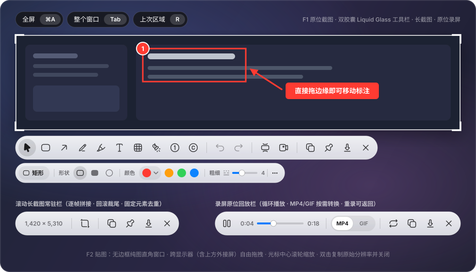

<div align="center">
  

  <h1>Pinny</h1>
  <p><strong>macOS 原位截图、滚动长截图、原位录屏（MP4 / GIF）、标注与纯图贴图工具</strong></p>

  <p>
    
    
    
    <a href="./LICENSE"></a>
  </p>

  <p>
    <a href="#功能概览">功能概览</a> •
    <a href="#快捷键">快捷键</a> •
    <a href="#构建与安装">构建与安装</a> •
    <a href="#图标生成">图标生成</a> •
    <a href="#文档">文档</a>
  </p>

  
</div>

---

Pinny 将区域截图、界面元素识别、原位标注、逐帧滚动长截图、选区录屏回放与剪贴板贴图收敛为两个全局快捷键：**`F1` 截图**与 **`F2` 贴图**。无前置模式选择，无右下角中转卡片，所有操作均在选区原位完成。

## 功能概览

### 1. 原位截图（`F1`）

- **选区与界面元素识别**
  - 按 `F1` 在每块显示器上同时打开截图浮层（Release 热启动首帧约 85 ms），跨屏拖拽选框实时共享。
  - 移动光标时通过系统辅助功能接口（`AXUIElement`）自动高亮光标下的界面元素；所有跨进程查询均在后台线程执行（`0.5 s` 超时），绝不阻塞主线程。
  - **滚轮切换层级**：物理向上/向下滚动鼠标滚轮或触控板，在父级与子级元素间逐级切换；单击即可锁定当前高亮元素，或按住左键直接手动框选。
  - **左上角深色快捷胶囊**：提供 `全屏 ⌘A`、`整个窗口 Tab`（按需实时获取窗口列表，不依赖自动检测开关）、`上次区域 R`（仅在有历史选区时显示，`,` 依次切换最近区域）。
- **选区调整、边缘吸附与统一光标**
  - 选择工具下拖拽选区空白处直接平移选区，拖拽四边或四角调整尺寸；调整选区大小时已有标注保持原尺寸，左/上边缩放后撤销历史自动同步偏移。
  - 移动或调整选区时，距屏幕边界、屏幕中线、可见窗口边或已识别元素边 `6 pt` 内自动吸附并触发触控板轻震反馈；按住 `⌘` 暂停吸附。
  - **统一光标规则**：未定选区时为十字准星；选区外与工具栏上为标准箭头；选区四边与四角为系统级上下/左右/斜向双箭头调整光标（macOS 15+ 原生 `NSCursor.frameResize`）；选择工具在选区空白处为张开/握紧的手；画图工具在选区内为十字，悬停于标注边缘为指向手/移动手势。

### 2. 原位标注与双胶囊工具栏

- **双胶囊原生液态玻璃面板（Option C）**
  - 默认贴靠选区下方（底部空间不足时切至上方），macOS 26+ 采用原生液态玻璃（`.glassEffect(.regular)`），自绘无焦点悬浮提示（主栏朝上、二级栏朝下）。
  - **主栏（`48 pt` 高胶囊）**：`36 pt` 圆形按钮、`20 pt` Hugeicons Pro 图标（常规态 `Stroke Rounded`，选中态 `Solid Rounded`），按 `标注工具` / `撤销重做` / `长截图·录屏` / `复制·钉图·保存·关闭` 分为 4 组，组间以细竖线分隔。
  - **二级属性栏（`40 pt` 高独立胶囊）**：位于主栏下方 `8 pt`、左对齐、按内容自适应宽度；「更多（`More`）」按钮固定在滚动区外，圆角等次级参数统一收纳其中，弹窗向下展开（弹窗打开时按 `⎋` 仅关闭最上层弹窗，不会误取消截图）。
- **标注工具与 PixPin 式交互**
  - **形状**：矩形（默认直角 `0`）、实心矩形、椭圆（二级栏切换，新会话默认矩形）。
  - **线条**：箭头（`ArrowUpRight03`，粗箭头自适应加长箭头翼）、直线（二级栏切换，新会话默认箭头）。
  - **画笔与标记**：铅笔、荧光笔（支持文字行自动对齐）、文字（固定 `PingFang SC`）、模糊（马赛克 / 高斯模糊，支持更细腻的轻度档位与实时预览）、聚光灯（支持背景暗度滑杆）、序号圆圈（自动黑白对比字色）、水印。
  - **画图工具直接拖边缘移动**：在矩形、箭头等任意画图工具下，直接按住已有标注（含刚画完的标注）的边缘拖动即可移动位置，单击边缘选中，在图形内部拖动继续绘制新标注（按住 `⌥` 可强制在边缘上画新标注）。
  - **智能参数记忆（`toolParameterDefaults.v2`）**：仅线框类工具共享颜色与描边粗细；模糊、荧光笔、序号、水印、聚光灯各自独立保存参数；调整刚画出的标注会同步更新该工具默认值，修改旧标注只影响自身。
  - **文字底色自动反白**：文字切至「底色标签」或「对话框」样式且背景透明时，自动取当前文字色作为底色，并将文字转为高对比度白色或黑色，同时重算文本框尺寸；切回纯文本自动恢复。

### 3. 滚动长截图

- 在 `F1` 工具栏点击「长截图」（`CarouselVertical` 图标），直接以当前选区进入滚动截取，右侧实时显示拼接预览窗。
- **逐帧拼接与回滚自动裁尾**：按帧匹配纵向位移（置信度阈值 `0.75`）；快速滑动失配时在末尾三屏范围内按行签名重定位；向上回滚时自动裁除已拼入的多余尾部。
- **固定元素去重**：自动检测顶部导航栏、底部悬浮按钮等不随内容滚动的固定区域，首尾各只保留一次；手动顶部裁剪位置在后续拼接中作为固定行保留。
- **常驻操作栏**：选区下方常驻显示当前长图像素尺寸、上下裁剪（`Crop`）、复制、钉图、保存与关闭；会话期间通过全局按键拦截响应 `↩`、`⌘C`、`⌘S` 与 `⎋`。

### 4. 原位录屏与循环回放

- **录屏准备栏**：在 `F1` 工具栏点击「录屏」（`Video01` 图标），工具栏原地切换为准备栏（选区像素尺寸、系统声音开关、麦克风开关、「开始录制」红色胶囊按钮与关闭），此时仍可自由拖动和调整选区；按 `↩` 开始录制，按 `⎋` 退回截图工具栏。
- **录制中**：选区外侧显示红框，下方常驻计时小条（`0:12` 格式、暂停/继续、停止）；再按 `F1` 或点击菜单栏红点同样停止录制。红框与小条不进入录像画面。
- **原位循环播放与按需转 GIF**：
  - 停止后立即在选区原位置、原尺寸循环播放刚录制的视频，下方操作栏提供暂停/播放、进度条、`MP4 / GIF` 胶囊切换、重录、复制（`↩` / `⌘C`）、保存（`⌘S`）与关闭（`⎋`）。
  - 录制全程采用高帧率 MP4；切到 `GIF` 时仅在点击复制或保存时按需流式转换（仅被点击按钮变为加载指示器，防止连按重复转换）。
  - **重录可返回**：点击「重录」先隐藏播放窗并打开带独立「返回」（`ArrowLeft02`）按钮的准备栏；按 `⎋` 或点击返回即可回到刚才那段录像，只有真正开始新录制时才丢弃旧录像；未复制也未保存就点击关闭时会弹窗确认。

### 5. 输出与纯图贴图（`F2`）

- **极速复制、保存与原位钉图**
  - **复制**（`↩` / `⌘C` / 双击选区空白处）：立即收起浮层，后台完成原始分辨率编码并写入剪贴板（多次快速复制以最新一次为准，不写入体积庞大的冗余 TIFF），同时在剪贴板项中记录源屏幕坐标与逻辑尺寸。
  - **钉图**：直接将当前选区（含标注）按原屏幕坐标与逻辑尺寸钉在原位；长截图钉图左上角对齐原选区，超出屏幕高度时等比缩放。
  - **保存**（`⌘S`）：保存至 `~/Downloads/Pinny`（首次安装默认为 `~/Desktop/Pinny`，若目录在废纸篓中自动回退），文件名前缀 `Pinny_`；保存失败时自动回退至剪贴板并提示。
- **纯图直角贴图（`F2`）**
  - 读取剪贴板中的图片或复制的图片文件并在屏幕生成贴图（自动跳过非图片文件，无图片时给出提示；若 `F1` 后台复制尚未完成则自动等待后贴出）。
  - 来自 Pinny 的剪贴板图片按原屏幕坐标与逻辑尺寸原位恢复；外部图片在当前屏幕居中，小图保持原尺寸，超屏大图等比缩放。
  - **纯粹交互**：无边框直角纯图窗口，无任何悬浮按钮；支持跨显示器（含跨越菜单栏进入上方外接屏）拖拽、以光标为中心平滑滚轮缩放、显示器拓扑变化时自动保持在屏幕可见范围内、**双击复制原始分辨率图像并关闭贴图**（关闭后按 `F2` 仍可恢复关闭前的位置与尺寸）；仅当前聚焦的贴图响应 `⎋` 关闭，不受其他应用按键干扰。

---

## 快捷键

### 全局快捷键

| 按键 | 功能 |
| :--- | :--- |
| `F1` | 打开原位截图浮层（录制中再次按下为停止录制） |
| `F2` | 将剪贴板中的图片或图片文件贴到屏幕 |

### 选区阶段（未确定选区）

| 操作 / 按键 | 功能 |
| :--- | :--- |
| 移动光标 | 自动高亮光标下的界面元素或窗口 |
| 滚轮上 / 下 | 切换父级 / 子级界面元素（`⌘` + 滚轮缩放放大镜） |
| 左键单击 / 拖拽 | 选中当前高亮元素，或手动框选区域 |
| `⌘A` | 选中当前显示器全屏 |
| `Tab` | 选中光标下的整个窗口（按需实时查询窗口列表） |
| `R` / `,` | 复用上次截图区域 / 依次切换最近历史区域 |
| `C` | 复制放大镜当前像素颜色值 |
| `⎋` / 右键单击 | 取消截图 |

### 标注阶段（已确定选区）

| 操作 / 按键 | 功能 |
| :--- | :--- |
| 拖拽选区空白处 | 平移选区（选择工具下直接拖拽，画图工具下可按住 `Space` 拖拽） |
| 拖拽四边 / 四角 | 调整选区尺寸（按住 `⌘` 暂停边缘吸附，已有标注保持原尺寸） |
| 方向键 | 按像素微调选区位置 |
| `⌘` / `⌥` + 方向键 | 向外扩展 / 向内收缩选区边缘 |
| `1` – `9`、`0` 或工具字母键 | 切换标注工具（无需先点击画布；再次按下切回选择工具） |
| 拖拽任意标注边缘 | **直接移动该标注**（即使当前处于矩形、箭头等画图工具下；单击边缘为选中，`⌥` + 拖拽强制画新标注） |
| `,` / `.` | 减小 / 增大当前标注描边粗细 |
| `⌘Z` / `⇧⌘Z` | 撤销 / 重做标注（含模糊类型与水印编辑） |
| `⌫` | 删除选中的标注 |
| `↩` / `⌘C` / 双击空白处 | 复制原始分辨率截图并立即关闭浮层 |
| `⌘S` | 保存截图至导出目录 |
| `⎋` | 若二级栏弹窗打开则先关弹窗；否则取消截图 |

### 滚动长截图与原位录屏

| 场景 | 操作 / 按键 | 功能 |
| :--- | :--- | :--- |
| **滚动长截图** | 向下 / 向上滚动 | 逐帧拼接长图 / 向上回滚自动裁除尾部 |
| | `↩` / `⌘C` | 复制完整长图并结束会话 |
| | `⌘S` | 保存长图至导出目录 |
| | `⎋` | 取消长截图 |
| **录屏准备栏** | `↩` | 开始录制当前选区 |
| | `⎋` | 返回截图工具栏（若从「重录」进入，则回到上一段录像回放） |
| **录制进行中** | `F1` / 点击停止 | 停止录制并进入原位循环回放 |
| **原位回放栏** | `↩` / `⌘C` | 按当前所选格式（`MP4` 或 `GIF`）复制文件到剪贴板并关闭 |
| | `⌘S` | 按当前所选格式保存至导出目录 |
| | `⎋` | 关闭回放（若未复制也未保存会先提示确认） |

### 贴图窗口

| 操作 / 按键 | 功能 |
| :--- | :--- |
| 左键拖拽 | 移动贴图（可跨越菜单栏拖入上方外接显示器） |
| 滚轮 / 双指滚动 | 以光标为中心平滑等比缩放贴图 |
| 双击贴图 | 复制原始分辨率图像（附带当前位置与尺寸）并关闭该贴图 |
| `⎋` | 关闭当前聚焦的贴图（忽略后台其他应用的 `⎋` 按键） |

---

## 构建与安装

**环境要求**：macOS 13.0+（原生液态玻璃需 macOS 26+），Xcode 15.0+，Apple Silicon (`arm64`)。

日常安装使用 **Release 优化构建**配合本地稳定证书签名，以确保覆盖更新后 macOS 的「屏幕录制」「辅助功能」与「麦克风」TCC 权限持久有效。

### 一键编译、签名与安装（推荐）

```bash
./scripts/install-pinny.sh --identity 'V2Do Dev'
```

该脚本会自动完成以下步骤：
1. 编译 `Release` 优化版（`../build/release`）；
2. 调用 `scripts/package-preview.py` 将产物打包为 `../build/preview-staged/Pinny.app`（Bundle ID `com.tianruian.openshot.preview`，移除 Sparkle 自动更新并用指定证书执行 `--deep --strict` 签名验证）；
3. 退出正在运行的 Pinny，将旧版 `/Applications/Pinny.app` 备份为单份 `.bak` 回退包（`../build/preview/`），覆盖安装至 `/Applications/Pinny.app` 并启动。

> 若已编译好 Release 产物、仅需重新打包安装，可加 `--skip-build`：
> ```bash
> ./scripts/install-pinny.sh --identity 'V2Do Dev' --skip-build
> ```

安装后请在 **设置 → 权限** 与 **设置 → 截图** 中确认「屏幕录制」「辅助功能」为已授予，「自动检测窗口」与「识别窗口内部元素」为开启状态。

---

## 图标生成

- **应用图标与菜单栏图标**（Hugeicons Pro `Aperture` Solid Rounded，需 `librsvg` 与 `Pillow`）：
  ```bash
  python3 scripts/generate-pinny-icon.py
  ```
- **内联工具栏与录屏操作栏图标**（主栏、二级栏与录屏栏 `CaptureTool-*.imageset`）：
  ```bash
  python3 scripts/generate-toolbar-icons.py <hugeicons-pro-unpacked-dir>
  ```
  映射与生成规格详见 [docs/HUGEICONS.md](docs/HUGEICONS.md)。

---

## 文档

- [核心概念说明](CONTEXT.md)
- [统一原位截图、长截图、录屏与贴图流程](docs/UNIFIED-CAPTURE.md)
- [工具栏 Hugeicons Pro 图标规格](docs/HUGEICONS.md)
- [本地开发与测试指南](docs/DEVELOPMENT.md)
- [编译与打包指南](docs/BUILD.md)
- [文档总索引](docs/README.md)
- [代码目录与运行时结构](docs/STRUCTURE.md)

---

## 许可与致谢

- 本项目基于 [BSD 3-Clause License](LICENSE) 开源。
- 衍生自 [Snapzy](https://github.com/duongductrong/Snapzy)（原作者 Trong Duong Duc），在此基础上围绕 `F1` 原位工作流与 `F2` 纯图贴图进行了深度重构与体验打磨。
- 配置文件存放于 `~/.config/pinny/config.toml`（首次启动若不存在会自动从 `~/.config/snapzy` 迁移）；为兼容既有系统授权与数据，Xcode target、URL Scheme（`snapzy://`，仅放行截图与可见设置页）及应用支持目录（`~/Library/Application Support/Snapzy`）沿用原标识符。
