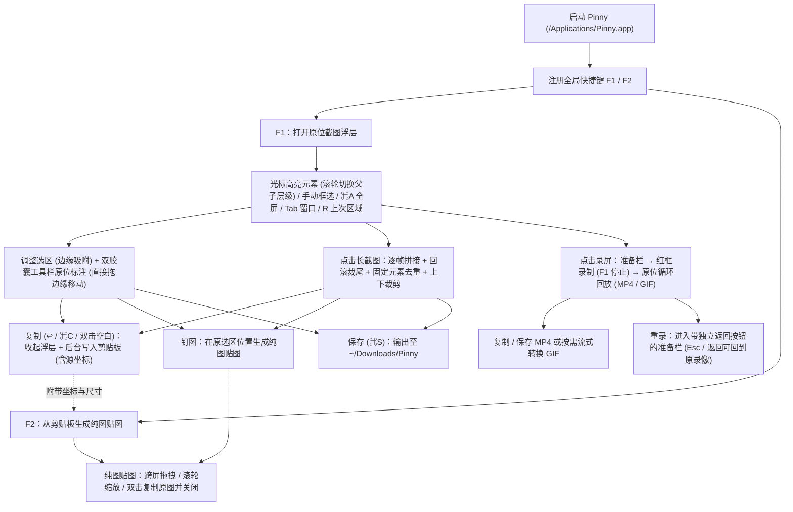

# Pinny 文档索引

本目录包含 Pinny 的交互规范、构建脚本说明与各模块设计文档。

## 常用文档

| 文档 | 内容 |
| --- | --- |
| [`../README.md`](../README.md) | 功能概览、快捷键速查、一键编译安装与图标生成步骤 |
| [`../CONTEXT.md`](../CONTEXT.md) | 核心术语与运行时概念定义 |
| [`UNIFIED-CAPTURE.md`](UNIFIED-CAPTURE.md) | `F1` 原位截图、长截图、原位录屏、双胶囊标注工具栏与 `F2` 贴图交互规范 |
| [`HUGEICONS.md`](HUGEICONS.md) | 工具栏与录屏栏 Hugeicons Pro 图标映射及生成脚本说明 |
| [`DEVELOPMENT.md`](DEVELOPMENT.md) | 本地开发、单元测试运行与调试命令 |
| [`BUILD.md`](BUILD.md) | 一键安装脚本、Release 编译、图标生成与 `package-preview.py` 打包流程 |
| [`STRUCTURE.md`](STRUCTURE.md) | 源码目录结构、运行时组件与持久化说明 |

## 已启用核心模块

| 文档 | 覆盖范围 | 当前状态 |
| --- | --- | --- |
| [`CAPTURE.md`](CAPTURE.md) | 屏幕捕获、选区浮层、窗口与 `AXUIElement` 元素识别 | **启用**（收敛至 `F1` 浮层，后台辅助功能查询 + 滚轮切换父子层级 + 边缘吸附） |
| [`ANNOTATE.md`](ANNOTATE.md) | 双胶囊内联标注工具栏、形状/线条二级分组、画布渲染 | **启用**（Option C 双胶囊 Liquid Glass、画图工具直接拖边缘移动标注、智能参数记忆） |
| [`SCROLLING_CAPTURE.md`](SCROLLING_CAPTURE.md) | 滚动长截图拼接管线、预览窗与常驻工具栏 | **启用**（从 `F1` 工具栏启动，逐帧拼接、回滚裁尾、固定元素去重、上下裁剪） |
| [`RECORDING.md`](RECORDING.md) | 选区录屏、音频采集与原位循环回放 | **启用**（从 `F1` 工具栏进入准备栏 → 红框录制 → 原位循环播放 + MP4/GIF 按需转换 + 重录可返回） |
| [`QUICK_ACCESS.md`](QUICK_ACCESS.md) | 贴图窗口（Pin Window） | **仅启用贴图窗口**（无边框直角纯图、跨屏拖拽、滚轮缩放、双击复制并关闭） |
| [`PREFERENCES.md`](PREFERENCES.md) | 设置窗口与偏好存储 | **启用**（精简为通用、截图/录屏、标注、贴图、快捷键、权限、高级/关于 7 页） |
| [`SHORTCUTS.md`](SHORTCUTS.md) | 全局快捷键（`F1` / `F2`）、会话内快捷键与 `snapzy://` | **启用**（`snapzy://` 仅放行截图与可见设置页） |
| [`APP_LIFECYCLE.md`](APP_LIFECYCLE.md) | 启动引导、菜单栏与权限状态缓存 | **启用** |
| [`LIQUID_GLASS.md`](LIQUID_GLASS.md) | Liquid Glass 面板封装 | **启用**（macOS 26+ 原生 `.glassEffect(.regular)`） |
| [`LOCALIZATION.md`](LOCALIZATION.md) | 多语言文案目录 | **启用** |
| [`CONFIGURATION.md`](CONFIGURATION.md) | `~/.config/pinny/config.toml` 导入导出 | **启用**（首次启动自动从 `~/.config/snapzy` 迁移） |

## 源码保留但界面隐藏的模块

以下模块保留在工程中以维持编译与测试完整，不在菜单栏、设置页或全局快捷键中暴露：

- **独立视频编辑器**：[`VIDEO_EDITOR.md`](VIDEO_EDITOR.md)
- **旧版截图后动作矩阵**：[`POST_CAPTURE.md`](POST_CAPTURE.md)
- **历史面板与云上传**：[`HISTORY.md`](HISTORY.md) · [`CLOUD.md`](CLOUD.md)
- **Sparkle 自动更新与上游发布流**：[`UPDATES.md`](UPDATES.md) · [`RELEASES.md`](RELEASES.md) · [`UPDATE_TESTING.md`](UPDATE_TESTING.md)

## 核心流程

