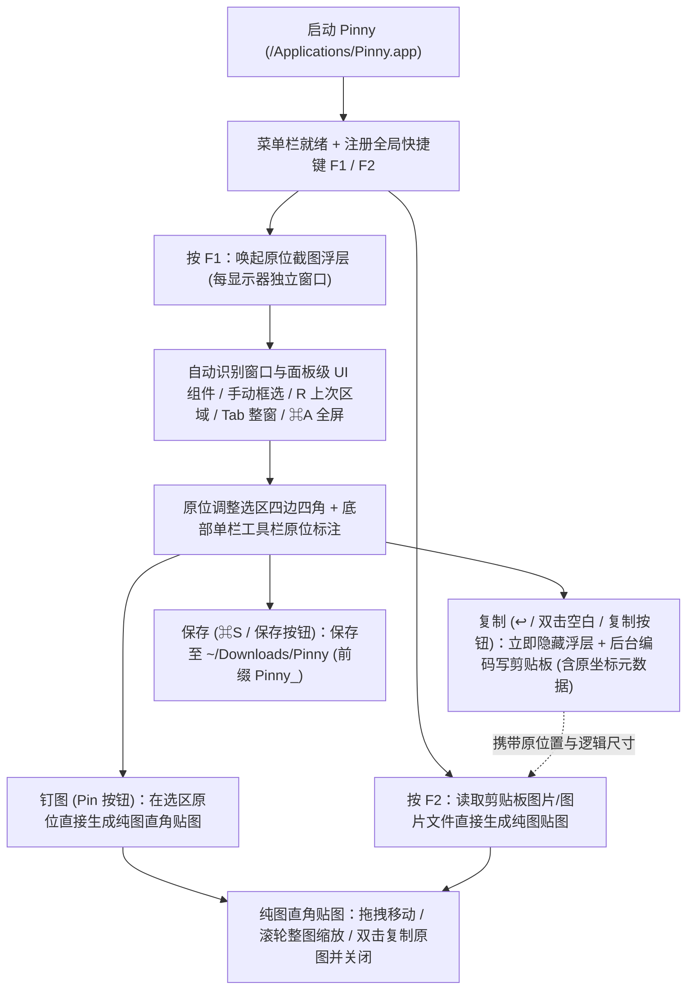

# Pinny 文档总览 (Documentation Map)

本目录汇总 Pinny（基于 Snapzy 深度定制的个人自用 macOS 原位截图、标注与纯图贴图工具）的流程说明、构建指南与底层模块文档。

## 核心必读（Pinny 主流程）

| 文档 | 内容说明 | 何时阅读 |
| --- | --- | --- |
| [`../README.md`](../README.md) | Pinny 功能概览、快捷键速查、Release 编译打包与安装规范 | 任何新会话 / 日常使用与维护 |
| [`UNIFIED-CAPTURE.md`](UNIFIED-CAPTURE.md) | 统一原位截图（`F1`）、原位标注与纯图直角贴图（`F2`）核心交互说明 | 修改截图、选区、工具栏或贴图逻辑时 |
| [`HUGEICONS.md`](HUGEICONS.md) | 内联工具栏 Hugeicons Pro 矢量图标生成与映射说明 | 修改或新增工具栏图标时 |
| [`DEVELOPMENT.md`](DEVELOPMENT.md) | 本地开发环境、单元测试运行与 Release 稳定签名打包流程 | 本地编译、调试或运行测试时 |
| [`BUILD.md`](BUILD.md) | Release 编译、应用光圈图标生成、`package-preview.py` 打包与安装 | 更新 `/Applications/Pinny.app` 时 |
| [`STRUCTURE.md`](STRUCTURE.md) | 源码目录结构、运行时架构、数据持久化与测试组织 | 了解代码结构或定位模块时 |

## 核心模块文档

| 文档 | 覆盖范围 | Pinny 当前状态 |
| --- | --- | --- |
| [`CAPTURE.md`](CAPTURE.md) | 截图底层机制、选区浮层、窗口与 `AXUIElement` 组件识别 | **核心启用**（统一收敛至 `F1` 原位流程，辅助功能查询已移至后台线程并设 `0.5 s` 超时） |
| [`ANNOTATE.md`](ANNOTATE.md) | 原位标注工具（Inline Capture Markup）与独立标注器架构 | **核心启用**（`F1` 内联单栏工具栏默认在选区下方，文字固定使用 `PingFang SC`） |
| [`QUICK_ACCESS.md`](QUICK_ACCESS.md) | 贴图窗口（Pin Window）与旧版角落悬浮卡片 | **仅启用纯图贴图**（直角纯图像、拖拽移动、滚轮缩放、双击复制原图并关闭；右下角卡片已停用） |
| [`PREFERENCES.md`](PREFERENCES.md) | 设置面板页签与偏好项存储机制 | **已精简为 7 页**（通用 / 截图、标注、贴图 / 快捷键、权限、高级 / 关于） |
| [`SHORTCUTS.md`](SHORTCUTS.md) | 全局快捷键（仅保留 `F1`/`F2`）、选区与标注快捷键、`snapzy://` 深链接 | **核心启用**（旧版分散截图与录屏全局快捷键已全部退役） |
| [`APP_LIFECYCLE.md`](APP_LIFECYCLE.md) | 启动流程、引导页、菜单栏图标与权限检查 | **核心启用**（菜单栏已精简，签名身份校验在每进程缓存一次以加速 `F1` 响应） |
| [`LIQUID_GLASS.md`](LIQUID_GLASS.md) | Liquid Glass 视觉组件体系 | **核心启用** |
| [`LOCALIZATION.md`](LOCALIZATION.md) | 多语言目录结构与本地化文案规范（界面文案已替换为 Pinny） | **核心启用** |
| [`CONFIGURATION.md`](CONFIGURATION.md) | `~/.config/snapzy/config.toml` 配置导入导出与同步 | **保留可用**（设置 → 高级） |

## 源码保留但界面已隐藏的原版模块

以下模块在源码中保留以维持工程与测试完整，但在 Pinny 的菜单栏、设置页与全局快捷键中已隐藏/退役：

- **录屏与视频编辑**：[`RECORDING.md`](RECORDING.md) · [`VIDEO_EDITOR.md`](VIDEO_EDITOR.md)
- **滚动长截图**：[`SCROLLING_CAPTURE.md`](SCROLLING_CAPTURE.md)
- **旧版截图后动作矩阵**：[`POST_CAPTURE.md`](POST_CAPTURE.md)
- **历史记录面板**：[`HISTORY.md`](HISTORY.md)
- **云上传（S3 / R2 / Google Drive）**：[`CLOUD.md`](CLOUD.md)
- **Sparkle 自动更新与公开发布流程**：[`UPDATES.md`](UPDATES.md) · [`RELEASES.md`](RELEASES.md) · [`UPDATE_TESTING.md`](UPDATE_TESTING.md)（Pinny 打包时已移除 `SUFeedURL` 并禁用自动更新）

## Pinny 主流程图

